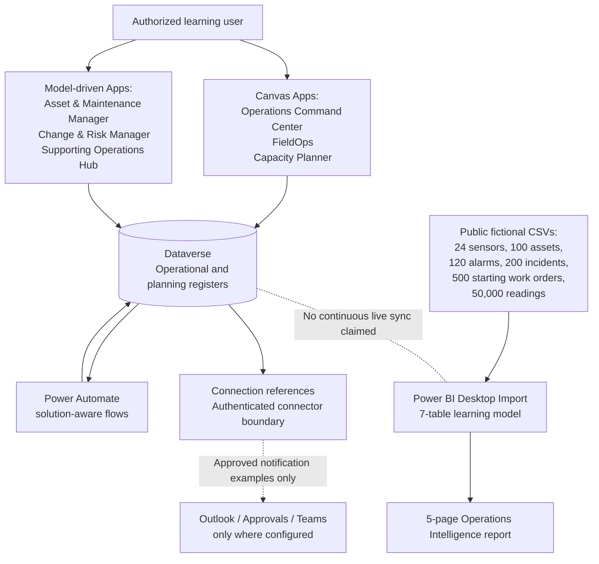

# Data Center Operations 360 — Architecture and trust boundaries

[Case study](./Case-Study.md) · [Build Guide](../Build-Guide.md) · [Evidence matrix](./Evidence-Matrix.md)

The architecture uses fictional SunnyVerse Renewable Group records to demonstrate a connected Power Platform solution. The diagram shows **documented application and data boundaries**, not a deployed live data-center telemetry network.

## Application and data flow

## Domains and actual separation

| Domain | System of record in the learning design | Key relationships / limitations |
| --- | --- | --- |
| Organization & facility | Dataverse | Department → Employee Profile; Campus → Data Hall |
| Equipment & alarms | Dataverse | Data Hall → Asset → Sensor; alarms and incidents link to their existing sources |
| Engineering work | Dataverse | Incident / Asset → Work Order; maintenance, changes and procedure reviews |
| Supporting operations | Dataverse | Vendor, Spare Part, Inventory Balance, Shift Handover |
| Rack and hall planning | Dataverse | Data Hall + Asset → Rack Plan → Allocation; Capacity Request is a separate non-reserving proposal |
| Rules-first intelligence | Dataverse + one manual flow example | Rule → Insight plus linked Incident, Work Order or Balance; human review is explicit |
| Monitoring analytics | CSV + Power BI Desktop | 50,000 synthetic sampled measurements; **not** an active Dataverse ingestion stream |

**Important:** Dataverse relationship direction in the logical model may read “Campus has many Halls”; the physical child record stores the **Lookup**. A report's aggregation of source CSV snapshots is not a direct connection to live tenant transactions. Choice display labels are not interchangeable with their actual saved numeric option values.

## Architecture decision record (public-safe)

| ID | Decision | Reason | Trade-off / follow-up |
| --- | --- | --- | --- |
| ADR-01 | Keep transactional operational records in Dataverse | Business keys, Lookups, Choices, forms, ownership and Power Apps integration | Some custom tables lack enforced alternate keys; role separation needs testing |
| ADR-02 | Use a fixed fictional single-campus development scale | Reproducible joins and manageable maker exercises | Scale is not a load/performance proof |
| ADR-03 | Store high-volume training readings as published CSV and analyze in Power BI Import mode | Avoid assuming premium SQL/gateway or sufficient Dataverse capacity | No automatic telemetry ingestion or report refresh is claimed |
| ADR-04 | Separate Canvas and model-driven app responsibilities | Task-specific screens vs relational maintenance/governance views | More apps to maintain and share |
| ADR-05 | Require review for rules-based operational insights | Explainability and original-record evidence | No autonomous resolution, physical dispatch or safety approval |
| ADR-06 | Treat Capacity Planner validation as client-side educational logic | Demonstrates bounds, overlap and budget reasoning | No atomic server-side concurrent reservation prevention |
| ADR-07 | Use an unmanaged development export only as evidence | Demonstrates source ALM, manifest and dependency review | Target import and managed downstream deployment not verified |
| ADR-08 | Preserve test outcomes and unresolved findings | Prevents overstating readiness in a portfolio | Some UAT cases and accessibility/security findings remain open |

## Threat and trust boundaries

- **User identity:** fictional Employee Profile rows do not authenticate users or replace Microsoft Entra identities. Roles and sharing must be validated with authorized accounts.
- **Connectors:** Outlook/Approvals connection references can require signed-in owners even when a reference exists; do not publicize connection identifiers or real recipients.
- **Row integrity:** alternate keys can constrain code uniqueness where Active, but do not guarantee all multi-row business invariants. A client-side overlap precheck does not eliminate races.
- **Operational safety:** mock approvals and reviewed knowledge are not electronic signatures, electrical switching instructions or real permit-to-work authorization.
- **Publishing:** GitHub source files and screenshots are not evidence that apps, flows or Power BI Service datasets were deployed publicly.
- **Privacy:** no original unmanaged solution export, hash ledger, private UAT report, environment URL, tenant GUID or screenshot with identity information is part of this public architecture.

## What remains outside verified scope

Target-environment solution import, non-admin role-based testing, comprehensive accessibility remediation, server-side capacity concurrency handling, flow duplication cleanup, complete Play-mode regression, live monitor performance and Power BI Service publication are separate engineering tasks. They should be implemented and tested only with proper authorization—not inferred from a successful build-along.
