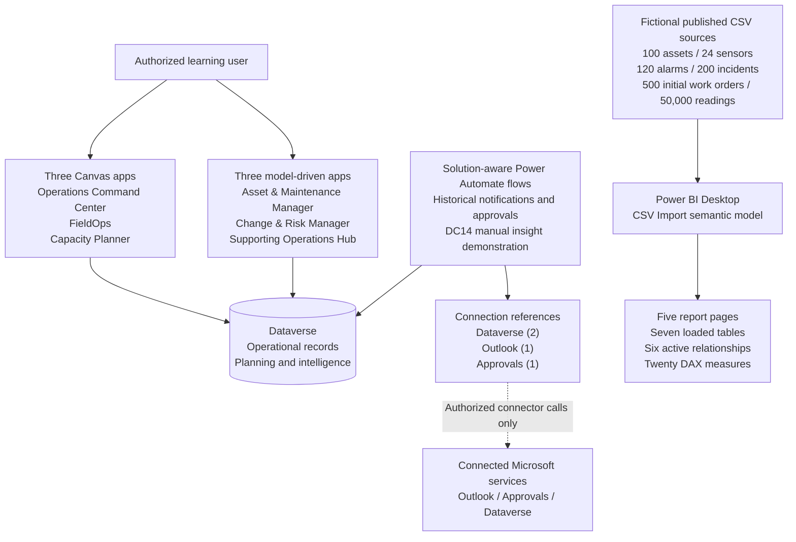

# Data Center Operations 360 — Architecture and trust boundaries

[Project case study](./Case-Study.md) · [Full Build Guide](../Build-Guide.md) · [End-to-end demonstration](./Demo-Walkthrough.md) · [Evidence index](./Evidence-Matrix.md)

This fictional learning project connects operational registers, focused Power Apps experiences, controlled cloud flows and a separate Power BI analytical model. It does **not** read live building systems, automate physical maintenance, grant permission through fictional employee records or deploy a production data-center platform.

## Application and connection architecture

**Connection direction is intentional:** flows use solution connection references to access Dataverse and supported Microsoft services. Dataverse does not directly operate the Outlook or Approvals connectors. The tested solution inventory contains **two Dataverse, one Outlook and one Approvals connection references**. A separate Teams integration may exist in other learning exercises, but **no Teams connection reference was identified in this solution**; it is not a supported link in this architecture diagram.

**Analytics boundary:** There is **no line from Dataverse to Power BI** in this diagram. The published Power BI teaching model imports the fictional CSV snapshots and sensor/asset dimensions from local files; it is not refreshed from Dataverse in real time. An out-of-range reading is not a Dataverse Alarm, and a planning reservation is not a measured facility load.

## Dataverse relationship map

| Business path | Child record stores | Why it matters |
| --- | --- | --- |
| Campus → Data Hall | Campus Lookup on Data Hall | Halls belong to the selected fictional Campus |
| Data Hall → Asset → Sensor | Data Hall Lookup on Asset; Asset Lookup on Sensor | Asset and sensor contexts resolve through saved parent records |
| Asset / Alarm → Incident → Work Order | Actual saved source relationships where configured | Operational records can be inspected without plain-text fake Lookups |
| Department → Employee Profile | Department and optional Manager Lookups | Fictional personnel records are not Entra-authenticated users |
| Spare Part / Data Hall → Inventory Balance | Real related part and hall Lookups | Quantities and Reorder Required remain manually maintained |
| Data Hall / Asset → Rack Plan → Rack Allocation | Actual planning Lookups | Reservation checks are client-side and not an atomic lock |
| DC Capacity Request | Separate planning request record | An initial request does not automatically consume rack units or power |
| Intelligence Rule → Operational Insight → Source | Insight stores required Rule plus optional real Incident, Work Order or Inventory Balance Lookup | Reviewed insights preserve original source evidence |

Organization-owned Dataverse tables, application sharing permissions, Choice metadata and relationship cascading are separate design concepts. In the latest maker-reported review, **8 of 24 tables have no Active alternate key**: current duplicate-free codes in those tables do not prove Dataverse uniqueness enforcement.

## Design decisions

| ID | Decision | Benefit | Engineering boundary |
| --- | --- | --- | --- |
| ADR-01 | Dataverse for transactional operations and planning | Real Lookups, forms, Choices and connected application experiences | Permissions and sharing must be tested with appropriate identities |
| ADR-02 | One fictional campus, two halls, fixed development-scale datasets | Repeatable learner steps and verifiable sample counts | Does not demonstrate high-volume transactional performance |
| ADR-03 | CSV + Power BI Desktop Import for 50,000 learning readings | Avoid assuming SQL, a gateway or Dataverse capacity for telemetry | No streaming data, live sensor ingestion or Power BI Service publication |
| ADR-04 | Three Canvas + three model-driven apps | Task-specific interaction plus relational operations/governance | Multiple apps create checker, accessibility and sharing work |
| ADR-05 | Guarded Power Automate and human-reviewed insight records | Traceable sources and explicit review | Historical deduplication does not ensure race-safe concurrent execution |
| ADR-06 | Capacity Planner as educational validation | Shows U-position, rack budget and hold decisions | Missing Hold/zero displays on an observed detail screen; no server-atomic booking |
| ADR-07 | Evidence-based ALM from unmanaged development export | Manifest/dependency inspection and private checksum | Target import, managed downstream deployment and recovery untested |
| ADR-08 | Preserve failing/open results | Honest portfolio and actionable engineering backlog | Checker findings and role-separated tests still unresolved |

## Observed interface and workflow limitations

During the latest maker-reported final walkthrough, **Rack 013 was confirmed Hold in its Dataverse record** but the Capacity Planner's Rack Detail did not show that status. **Reserved U and reserved kW displayed blank instead of 0**. Those are **display defects** to address separately; do not infer that the underlying planning rows were missing, and do not edit their values merely to create a clearer screenshot.

There are **five distinct solution flow records**. Two share the display name **DC08 Incident Status Notice**, but the newer record has **no recorded historical executions**. The fourteen previously reported successful runs break down as **4 older incident notice + 2 inspection follow-up + 6 change approval + 2 insight demonstration**. The second insight run skipped duplicate insertion. None of this establishes reliable concurrent writes, exercised cancelled paths or a safe reason to enable an Off flow.

## Security, deployment and evidence boundaries

- Do not equate a fictional Employee Profile with a Microsoft Entra identity or a manual review Choice with an authenticated approval.
- The inspected model-driven applications were shared with administrator/customizer roles; **role-separated least-privilege testing has not been completed**.
- **143 reported accessibility findings** in Capacity Planner require remediation; a zero-Formula-error checker result does not erase them.
- The unmanaged v1.0.0.0 solution export and its private hash do **not** prove import success, target dependency availability, data restore or enterprise deployment.
- Visuals in a developer environment may contain a banner, account details or environment information. Only actual redacted captures from authorized published app versions should be shared.
- The last Part 16 review did **not reopen Power BI Desktop** or capture a publishable video. Earlier Power BI checks and source files are separate evidence.

The architecture is a transparent model of the learner's documented build, with real limitations visible. See [the final case study](./Case-Study.md) for the concise presentation and [the verification checklist](../quality/Part-16-Final-Verification.csv) to repeat the checks in a new authorized environment.
